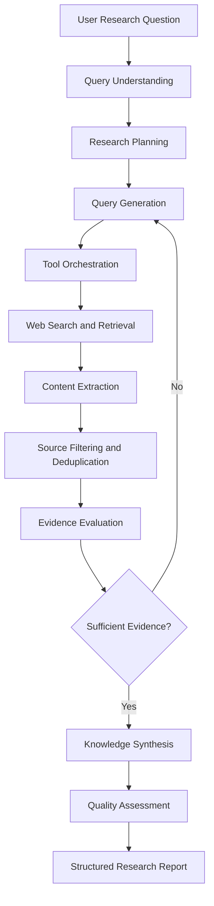
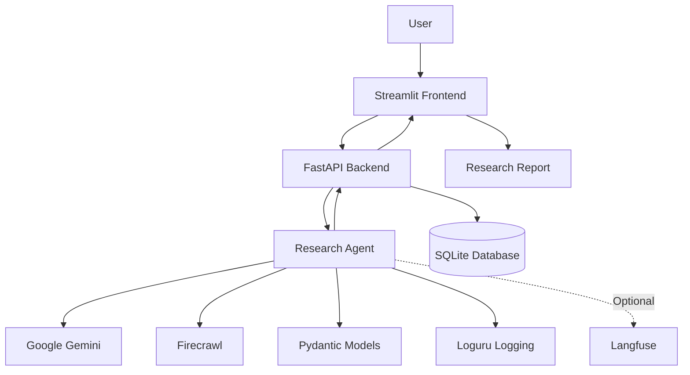

# Nexus AI — Autonomous Research Agent

**A production-oriented AI research agent that plans, searches, retrieves, evaluates, and synthesizes information into structured, evidence-backed research reports.**

Nexus AI aims to transform how complex research questions are investigated. Instead of simply generating answers from an LLM, it follows a structured research workflow involving autonomous planning, web retrieval, source evaluation, evidence synthesis, and quality assessment.

---

## Overview

Traditional AI chatbots can provide quick answers, but complex research requires more than a single response. It requires breaking down questions, collecting information from multiple sources, evaluating evidence, identifying gaps, and synthesizing reliable findings.

Nexus AI is designed to address this challenge through an agent-based research architecture.

The system accepts a natural-language research question and orchestrates a multi-stage workflow to generate a structured research report.

### Key Capabilities

- **Autonomous Research Planning:** Breaks complex questions into smaller research tasks and targeted search queries.
- **Web Research:** Uses Firecrawl for web search and content retrieval.
- **Source Processing:** Extracts, filters, and deduplicates relevant research material.
- **AI-Powered Synthesis:** Uses Google Gemini to generate structured research findings.
- **Structured Outputs:** Uses Pydantic models to validate research data and responses.
- **Research Persistence:** Uses SQLite to maintain research jobs and execution checkpoints.
- **Error Handling:** Implements retry mechanisms and handling for external service failures.
- **Observability:** Uses structured logging and optional Langfuse integration.
- **Interactive Interface:** Provides a Streamlit frontend connected to a FastAPI backend.

*Capabilities listed above describe the project implementation and intended design; individual features may have different levels of completion.*

---

## Research Workflow

The intended Nexus AI workflow follows these stages:

1. **User Query:** Accepts a research question in natural language.
2. **Query Understanding:** Identifies the research objective and relevant concepts.
3. **Research Planning:** Decomposes the question into smaller research tasks.
4. **Query Generation:** Generates targeted queries for information retrieval.
5. **Tool Orchestration:** Selects appropriate research tools.
6. **Information Retrieval:** Searches the web and retrieves relevant content.
7. **Source Processing:** Extracts useful information, removes duplicates, and filters irrelevant material.
8. **Evidence Evaluation:** Assesses source relevance and identifies information gaps.
9. **Iterative Research:** Performs additional searches when more evidence is required.
10. **Knowledge Synthesis:** Combines findings into a coherent research response.
11. **Quality Assessment:** Evaluates evidence coverage, uncertainty, and limitations.
12. **Final Report:** Produces a structured research report with supporting sources.

### Agent Workflow Diagram



---

## System Architecture

Nexus AI uses a modular architecture that separates the frontend, API layer, agent orchestration, external services, persistence, and observability.



### Architecture Components

| Component | Responsibility |
|---|---|
| Streamlit | Interactive research interface |
| FastAPI | Backend API and research job handling |
| Python Agent | Research orchestration and execution |
| Google Gemini | Planning and research synthesis |
| Firecrawl | Web search and content retrieval |
| Pydantic | Structured data validation |
| SQLite | Research persistence and checkpoints |
| Loguru | Application logging |
| Langfuse | Optional LLM tracing and observability |
| Pytest | Automated testing |

---

## Technology Stack

| Technology | Purpose |
|---|---|
| Python | Core application development |
| Google Gemini | LLM-powered research |
| Firecrawl | Web research and extraction |
| FastAPI | Backend API |
| Streamlit | Frontend |
| Pydantic | Data validation |
| SQLite | Persistence |
| Loguru | Logging |
| Langfuse | Optional observability |
| Pytest | Testing |

---

## Project Structure

```text
nexus-ai-research-agent/
│
├── app.py                  # Streamlit frontend
├── src/                    # Backend and agent implementation
│   ├── agent/              # Research agent components
│   └── api/                # FastAPI application
│
├── tests/                  # Automated tests
├── scripts/                # Demo and utility scripts
│
├── README.md               # Project documentation
├── EVALUATION.md           # Evaluation methodology and results
├── requirements.txt        # Python dependencies
├── .env.example            # Environment configuration template
└── .gitignore               # Git exclusions
```

*The directory tree highlights the main project components; inspect the repository for the complete module structure.*

---

## Getting Started

### Prerequisites

- Python 3.10 or newer
- Google Gemini API key
- Firecrawl API key
- Git

### 1. Clone the Repository

```bash
git clone https://github.com/YOUR_USERNAME/nexus-ai-research-agent.git
cd nexus-ai-research-agent
```

### 2. Create a Virtual Environment

```bash
python3 -m venv .venv
source .venv/bin/activate
```

### 3. Install Dependencies

```bash
pip install -r requirements.txt
```

### 4. Configure Environment Variables

Create your local environment file:

```bash
cp .env.example .env
```

Configure your credentials:

```env
GEMINI_API_KEY=your_gemini_api_key
GEMINI_MODEL=your_supported_gemini_model

FIRECRAWL_API_KEY=your_firecrawl_api_key

LANGFUSE_PUBLIC_KEY=
LANGFUSE_SECRET_KEY=
LANGFUSE_BASE_URL=https://cloud.langfuse.com
```

Never commit your actual `.env` file or API credentials.

### 5. Start the Backend

```bash
PYTHONPATH=. uvicorn src.api.main:app --reload
```

The backend runs at:

```text
http://localhost:8000
```

FastAPI documentation:

```text
http://localhost:8000/docs
```

### 6. Start the Frontend

Open another terminal, activate the virtual environment, and run:

```bash
PYTHONPATH=. streamlit run app.py
```

The Streamlit interface will be available at:

```text
http://localhost:8501
```

---

## Example Research Questions

Nexus AI is designed for complex, multi-step research questions such as:

**Artificial Intelligence**

- How do large language models work, from training to inference and optimization?
- Compare retrieval-augmented generation and fine-tuning for enterprise AI applications.

**Cloud and Infrastructure**

- Explain the architecture of Kubernetes and how its control plane manages workloads.
- Compare serverless computing platforms and their trade-offs.

**Cybersecurity**

- Investigate modern approaches to detecting anomalous network activity.
- Compare zero-trust security architectures across enterprise environments.

---

## Expected Research Report Structure

A completed research report is intended to contain:

1. Executive Summary
2. Research Objective
3. Key Findings
4. Detailed Analysis
5. Supporting Evidence
6. Source References and Citations
7. Comparisons and Insights
8. Assumptions and Limitations
9. Confidence and Coverage Assessment

---

## Reliability and Security Considerations

Nexus AI is developed with production-oriented engineering principles:

- API failure handling and retry mechanisms.
- Validation of external tool responses.
- Protection against untrusted instructions in retrieved content.
- Environment-based secret management.
- Persistent research state and execution checkpoints.
- Structured application logs.
- Automated tests for important application components.
- Awareness of latency, token usage, and external API limitations.

These practices are intended to improve reliability when working with external LLM and web-retrieval services.

---

## Evaluation

The project's evaluation approach focuses on:

- Research relevance.
- Source quality.
- Evidence coverage.
- Citation support.
- Response completeness.
- Error handling.
- Execution reliability.

Refer to **[EVALUATION.md](EVALUATION.md)** for the evaluation methodology and recorded results.

Confidence estimates should be interpreted according to the implemented assessment method and should not be treated as statistically calibrated probabilities unless independently validated.

---

## Future Roadmap

The longer-term vision for Nexus AI includes:

- More advanced autonomous research planning.
- Dynamic tool selection and orchestration.
- Iterative evidence-gap detection.
- Claim-level citation verification.
- Source credibility and freshness scoring.
- Research comparison and conflict resolution.
- Improved research history and recovery.
- Advanced tracing, cost monitoring, and evaluation.
- Extensible integrations for additional research sources.

---

## Design Philosophy

Nexus AI is built around one central idea:

**Research should be a process of investigation, evidence collection, validation, and synthesis — not simply text generation.**

The goal is to develop an AI research analyst capable of independently investigating complex questions while making its research process, evidence, and limitations transparent.

---

## License

Add an appropriate open-source license before distributing the project publicly.
